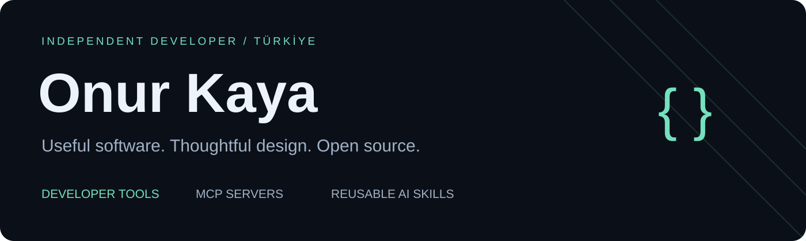

  

  <a href="https://github.com/kayaonur607?tab=repositories">Projects</a> ·
  <a href="https://apps.apple.com/tr/developer/onur-kaya/id6778129854">App Store</a> ·
  <a href="https://x.com/kayaonur607">X</a> ·
  <a href="mailto:kayaonur607@gmail.com">Email</a>

I'm **Onur**, an independent software developer based in Türkiye. I build software from the first idea through implementation, design and release. I care about clear interfaces, maintainable code and tools that solve practical problems.

My open-source work focuses on **developer tooling, MCP servers and reusable AI skills**. The projects I publish here are free and open source, with documented setup, versioned changes and clear limits.

## Featured project

### [Apple Native Engineer](https://github.com/kayaonur607/apple-native-engineer-mcp)

An Apple development and design toolkit for AI assistants, combining local audits, Apple documentation research and repeatable review workflows.

- **Inspect and review:** SwiftUI, accessibility heuristics, privacy manifests, localization and release checks.
- **Research and prepare:** Apple API documentation, platform availability, design tokens and App Store assets.
- **See the evidence:** regression tests, recorded MCP calls, an animated walkthrough and documented limitations.
- **Use it freely:** MIT licensed, local execution and versioned GitHub releases.

[Explore the repository](https://github.com/kayaonur607/apple-native-engineer-mcp) · [Watch the walkthrough](https://github.com/kayaonur607/apple-native-engineer-mcp/blob/main/assets/demo/usage-demo.mp4) · [Read the releases](https://github.com/kayaonur607/apple-native-engineer-mcp/releases)

## How I work

| Principle | In practice |
| --- | --- |
| Build something useful | Start with a specific problem and a working example. |
| Make progress inspectable | Document changes, tests and reproducible results. |
| Design with care | Keep interfaces understandable and workflows focused. |
| Share openly | Publish source, explain limitations and welcome constructive feedback. |

## What I'm building next

More focused open-source projects and reusable skills. New work will appear here as it becomes usable, with its own documentation and release history.

Bug reports, reproducible examples and documentation improvements are welcome in the relevant repository. For collaboration, reach me at [kayaonur607@gmail.com](mailto:kayaonur607@gmail.com).
